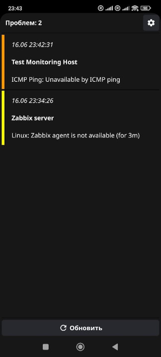
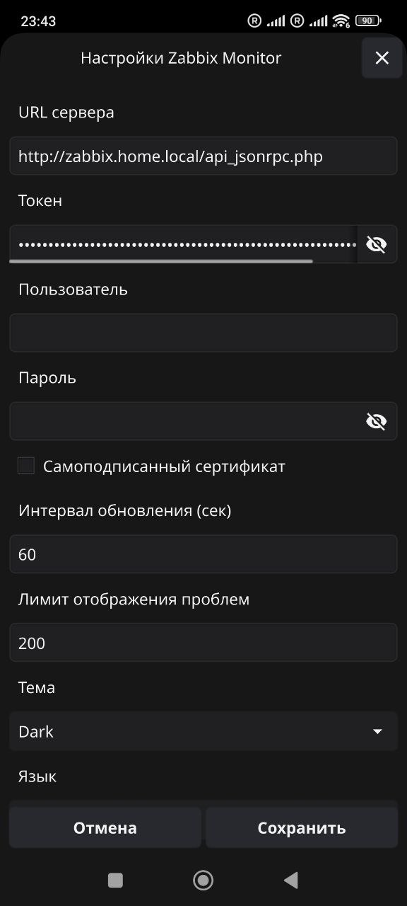

####  Zabbix Android API Client 
------

**Версия App**
```text
v0.8.3
```

**Версия Go**
```text
1.24.6
```

**Сборка Fyne**
```text
go install github.com/fyne-io/fyne-cross@latest
```

**Приложение для Android**
- Нужно сгенерировать на стороне сервера Token (или использовать логин/пароль)
- Можно получать текущие проблемы

<br>

<table>
  <tr>
    <td></td>
    <td></td>
  </tr>
</table>
